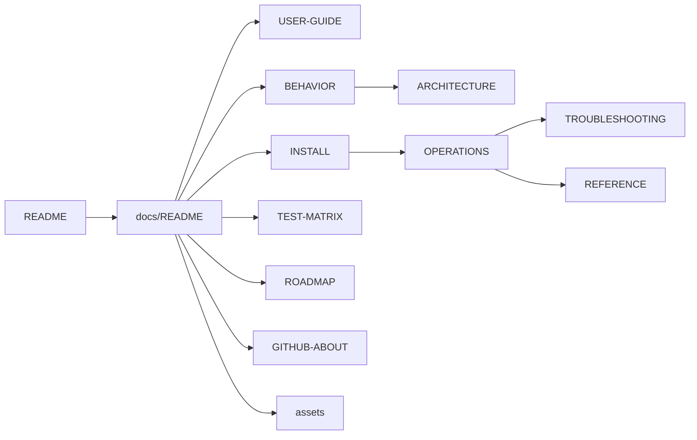

# Documentation

Front door for `docs/`: pick the right file by need. If marketing copy and code disagree, [BEHAVIOR.md](BEHAVIOR.md) and the scripts win.
Up: [README](../README.md) · Not here: agent rules ([AGENTS.md](../AGENTS.md)), release history ([CHANGELOG.md](../CHANGELOG.md)), the source scripts themselves (repo root).

## Routes

| Need / keywords | Open | Notes |
|:----|:----|:----|
| daily use, capture and paste, markup, disable, reenable | [USER-GUIDE.md](USER-GUIDE.md) | Everyday loops |
| what the code does today, contract, authoritative | [BEHAVIOR.md](BEHAVIOR.md) | Authoritative behavior |
| design, data flow, dual-path HDR, resources, TCC | [ARCHITECTURE.md](ARCHITECTURE.md) | Why it is built this way |
| install flags, layout, legacy migration, uninstall | [INSTALL.md](INSTALL.md) | Installer reference |
| health check, logs, restart agents | [OPERATIONS.md](OPERATIONS.md) | Running it |
| symptom, broken, not pasting, permissions | [TROUBLESHOOTING.md](TROUBLESHOOTING.md) | Decision tree: prefs, agents, logs, TCC, rebuild |
| paths, launchd labels, env vars, log lines | [REFERENCE.md](REFERENCE.md) | Lookup tables |
| manual acceptance, release checklist | [TEST-MATRIX.md](TEST-MATRIX.md) | Manual cases |
| planned features, preferences, requests | [ROADMAP.md](ROADMAP.md) | Undated plans |
| GitHub description, topics, social copy | [GITHUB-ABOUT.md](GITHUB-ABOUT.md) | Repository About text |
| hero image, demo GIF/MP4 | [assets/README.md](assets/README.md) | Media files and uses |

## Map

## Repository files

| Need | Open |
|:----|:----|
| Contribute | [CONTRIBUTING.md](../CONTRIBUTING.md) |
| Report a vulnerability, threat model | [SECURITY.md](../SECURITY.md) |
| Release history | [CHANGELOG.md](../CHANGELOG.md) |

## Contents

Using it

- [USER-GUIDE.md](USER-GUIDE.md): capture, paste, markup, disable and reenable
- [INSTALL.md](INSTALL.md): installer flags, layout, legacy migration, uninstall
- [OPERATIONS.md](OPERATIONS.md): health check, logs, restarting agents
- [TROUBLESHOOTING.md](TROUBLESHOOTING.md): symptom decision tree

How it works

- [BEHAVIOR.md](BEHAVIOR.md): authoritative description of current behavior
- [ARCHITECTURE.md](ARCHITECTURE.md): design, data flow, dual-path HDR, TCC
- [REFERENCE.md](REFERENCE.md): paths, launchd labels, env vars, log lines

Release and planning

- [TEST-MATRIX.md](TEST-MATRIX.md): manual acceptance and release checklist
- [ROADMAP.md](ROADMAP.md): planned features and requests
- [GITHUB-ABOUT.md](GITHUB-ABOUT.md): repository description, topics, social copy
- [assets/README.md](assets/README.md): hero image and demo media
